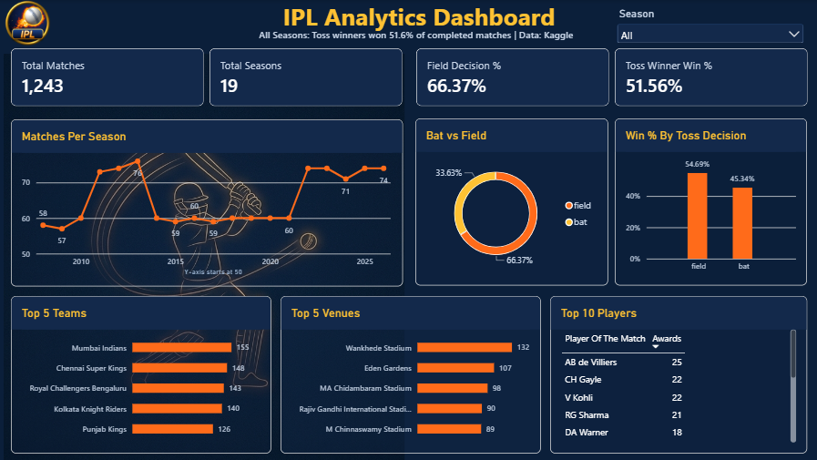
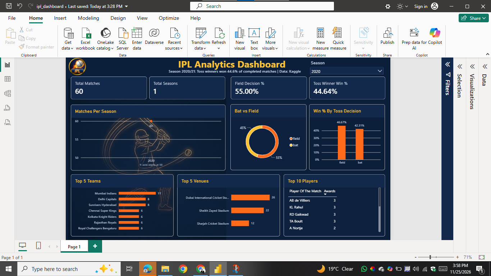

# IPL Matches Analysis (2008-2026)

End-to-end analysis of IPL match data using **Python (Pandas)**, **SQL** and **Power BI**.

## Problem
Does winning the toss help a team win the match? Which teams, venues and players stand out across seasons?

## Dataset
- Source: [Kaggle - IPL 2008-2026 matches dataset](https://www.kaggle.com/datasets/arjunsinghgangwar/ipl-20082026-matches-dataset)
- 1,243 matches across 19 seasons (1,218 with a complete result)

## Tools
Python (Pandas, Matplotlib), SQL (SQLite), Power BI (DAX)

## Data Cleaning
- Merged old and new team names (for example, Delhi Daredevils to Delhi Capitals)
- Mapped season labels such as `2007/08` to a single year
- Converted the date column to datetime
- Fixed duplicate venue names (venue with and without city)
- Fixed duplicate city names (Bangalore and Bengaluru)
- 51 matches have an `Unknown` city

## Key Insights
- Toss winners chose to **field in 66.37%** of matches (825 of 1,243)
- In completed matches, toss winners who chose to field won **54.7%**, compared to **45.3%** for those who chose to bat
- Overall, toss winners won only **51.56%** of completed matches
- Most wins: Mumbai Indians (155), Chennai Super Kings (148), Royal Challengers Bengaluru (143)
- Most matches hosted: Wankhede Stadium (132), Eden Gardens (107), MA Chidambaram Stadium (98)
- Most Player of the Match awards: AB de Villiers (25), CH Gayle (22), V Kohli (22)

## Dashboard Features
- KPI cards: total matches, total seasons, field decision %, toss winner win %
- Matches per season, bat vs field, win % by toss decision
- Top 5 teams, top 5 venues, top 10 players
- Season slicer with a dynamic insight line

## Files
| File | Description |
|---|---|
| `ipl_analysis.ipynb` | Data cleaning and analysis in Pandas |
| `ipl_matches_clean.csv` | Cleaned dataset |
| `ipl_queries.sql` | 8 SQL queries |
| `ipl_dashboard.pbix` | Power BI dashboard |
| `ipl_theme.json` | Custom Power BI theme |

## How to Run
1. Download the dataset from Kaggle and run the notebook (update the file path if needed).
2. Import `ipl_matches_clean.csv` into SQLite as a table named `matches`, with the first line as column names, then run `ipl_queries.sql`.
3. Open `ipl_dashboard.pbix` in Power BI Desktop.

## Author
**Prithvi Chouhan** - Aspiring Data Analyst
